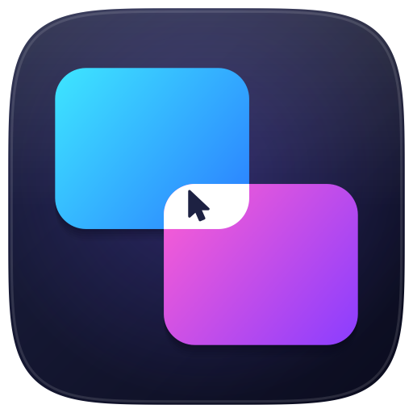
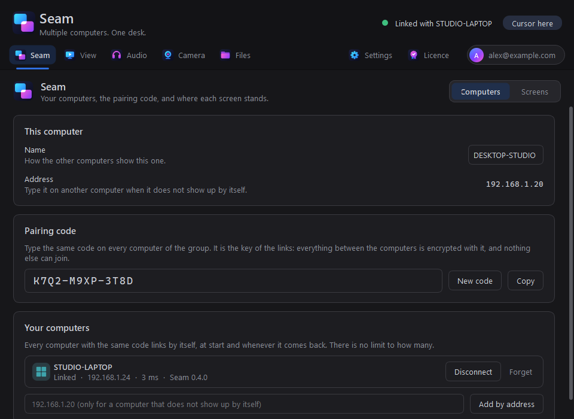
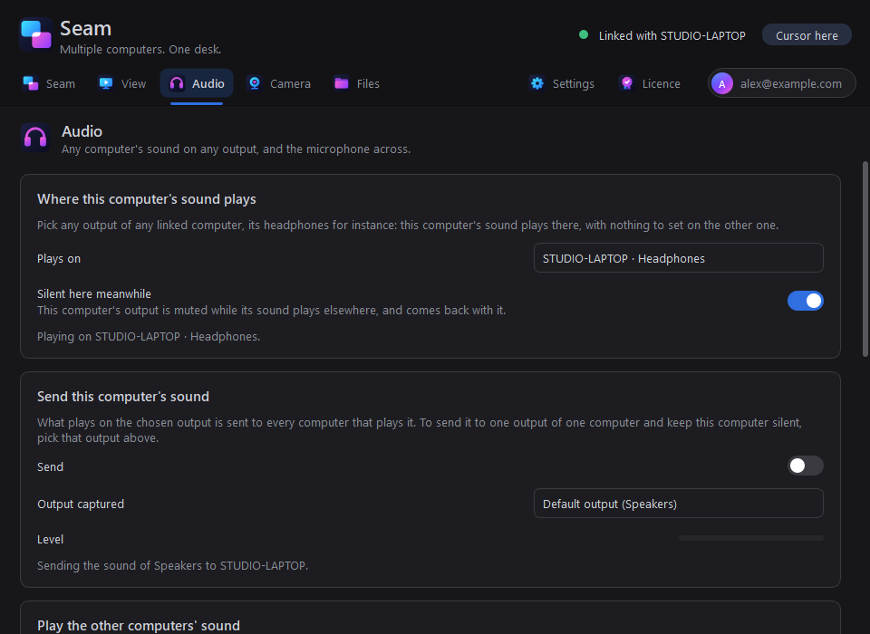
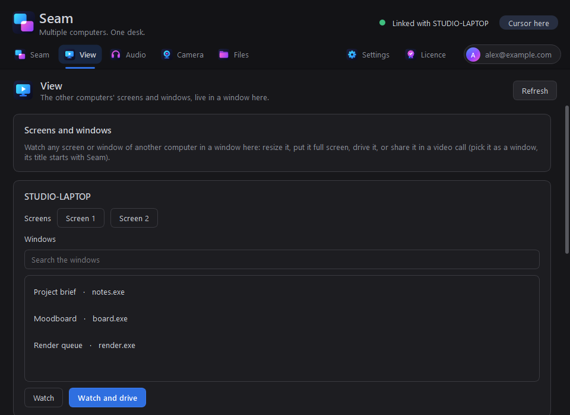
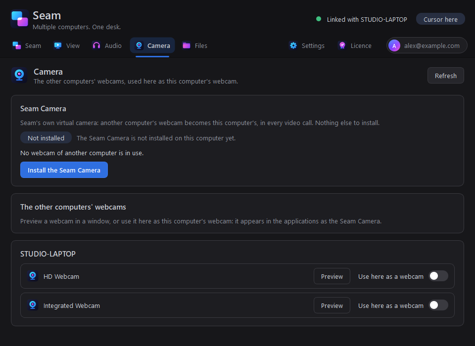
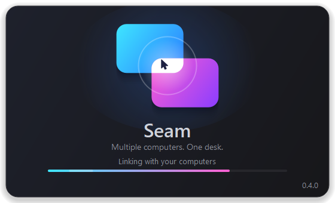

# Seam

### Multiple computers. One desk.

One mouse and one keyboard for every computer on your desk, and everything else follows them: the clipboard, files,
sound, screens and webcams. Push the cursor off the edge of one screen and it carries on onto the next computer, as if
they were one machine.

**[Download Seam for Windows](../../releases/latest)**

---

## Install

1. Download `SeamSetup-<version>.exe` from the [latest release](../../releases/latest) and run it. It installs for your
   account: no administrator needed.
2. The first time, Windows may say *Windows protected your PC*: click **More info**, then **Run anyway**.
3. Windows asks whether Seam may use the network: allow it on **private** networks.

Do the same on every computer of your desk.

## First start

1. **Create your Seam account**: your email and a password. One account for all your computers.
2. On the first computer: **Seam > New code**, then **Copy**. Type the same pairing code on every other computer: they
   find each other on the network within seconds and link, every computer with every other.
3. **Seam > Screens**: drag each computer where it stands on your desk. The layout is shared by the whole group.

## What it does

**Mouse and keyboard.** Lay your computers out the way they stand. Push the cursor out of an edge and it goes to the
computer behind it; the keyboard follows the cursor. Corners never cross, so they stay usable.

**Clipboard and files.** Copy on one computer, paste on any other: text with its formatting, pictures, files and whole
folders. Drag files out of an edge and the drag goes on on the next computer: let go in the folder or the application
you want. And the other computers' folders (Desktop, Documents, Downloads...) show in your file manager, to browse,
search and open like a drive.

**Sound anywhere.** Say which computer this computer's sound plays on: it comes out of whatever that computer plays on,
the headphones plugged into the laptop for instance, and this computer stays silent meanwhile. The microphone travels the
same way, one choice.

**Screens and windows.** Watch any screen or window of another computer, live, in a window here: resize it, put it full
screen, drive it with this mouse and keyboard, or share it in a video call. Drag a window out of an edge and it goes over
as the window itself, live and usable: click, type, resize or maximise it there; it can sit astride two computers, each
showing its part, its sound follows it to the computer holding more than half of it, and closing it there sends it home.

**Webcams.** Another computer's webcam becomes this computer's: the **Seam Camera** appears in every video call, with
nothing else to install.

**Private.** The computers of a group share a pairing code, and everything between them is encrypted with it. A computer
without the code cannot join.

**Light.** Alone, Seam stays out of the way of your mouse. Linked, a mouse event costs it a few microseconds, and game
mode steps aside while a full-screen game or film is in front.

## Free and Pro

Seam Free carries the mouse and the keyboard between two computers. Seam Pro adds everything else, for any number of computers. The Licence page shows each plan at work between two laptops, scene after scene: rest the pointer on a feature to watch that one alone.

## Languages and themes

English, French, Spanish, German, Italian, Portuguese, Japanese and Chinese. Ten colour themes and their accents.

## Updates

Seam checks this page for new versions: *Check for updates* in its tray menu, or *Settings > Updates*. A new version
installs in one click, over the old one, settings kept.

## Requirements

Windows 10 or 11, 64-bit. The computers on the same network, or reachable from one another by address. macOS and Linux
versions are on the way.

---

(c) 2026 Gregoire Dehame. All rights reserved.

